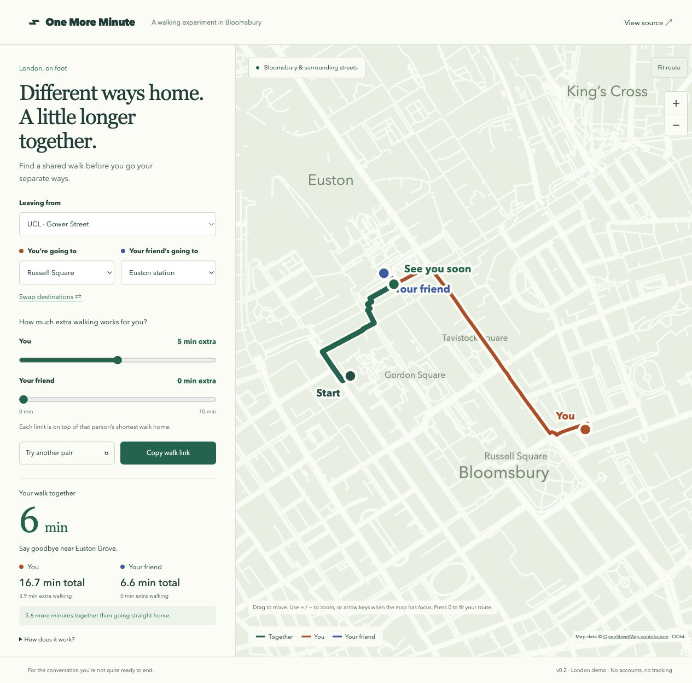

# One More Minute

You’re leaving campus with a friend. You live in different directions, but neither of you is quite ready to end the conversation.

Pick where you’re both going and how much extra walking each of you can spare. The app finds a route to share, then shows where to split off.

[Try it here](https://t7acct.github.io/one-more-minute/)



## Using it

Choose a starting point and two destinations around UCL. Each person gets their own extra-time slider, from 0 to 10 minutes. The totals show how long each walk takes and how much of it is a detour.

Green is the shared walk. Orange is your route afterwards; the dashed blue line is your friend’s. Drag the map to look around, or use the zoom buttons. With the map focused, arrow keys move it, + and − zoom, and 0 brings the route back into view.

**Copy walk link** saves both destinations and time limits in the URL. No account needed.

## Run it locally

You’ll need Python 3. There are no packages to install.

```sh
git clone https://github.com/t7acct/one-more-minute.git
cd one-more-minute
python3 -m http.server 4173 --bind 127.0.0.1
```

Open [localhost:4173](http://localhost:4173). Opening the HTML file directly won’t load the street data.

Tests use Node.js 22 or later:

```sh
npm test
```

## How the routes work

The street network is a graph. Each edge has a walking time based on its length, assuming 1.35 m/s (about 4.9 km/h).

For each possible goodbye point, the planner adds up:

```text
your walk     = start → goodbye point → your destination
friend’s walk = start → goodbye point → their destination
```

A route only qualifies if both people stay within their own extra-time limit. Routes that revisit a node are discarded. Of the remaining candidates, the planner picks the one with the most time together, breaking ties by the combined journey time.

[routing.js](routing.js) uses three Dijkstra searches with a binary min-heap. It considers shortest paths through each candidate junction, so it can miss better routes that use a different path to the same junction. It isn’t an exact solver for every possible walk.

The tests check shortest paths, separate time limits, dead ends, identical destinations, disconnected graphs and shared links. They also check that routes on the bundled map stay connected, avoid repeated nodes and respect the time limits.

## What’s missing

This version has 12 preset places and a fixed area around Bloomsbury. Place coordinates snap to nearby connected street nodes, so the short walk to a building entrance isn’t included. Crossing delays, gates, opening hours, accessibility and live closures aren’t accounted for either. Treat the times as estimates, not directions to follow blindly.

Address search and better pedestrian access data would be useful next steps.

## Map data and licence

The map is drawn as SVG from a bundled OpenStreetMap extract. The browser calculates routes locally; it doesn’t call a routing service or download map tiles.

Code is [MIT licensed](LICENSE). Map data is © [OpenStreetMap contributors](https://www.openstreetmap.org/copyright), under the [Open Database Licence](https://opendatacommons.org/licenses/odbl/1-0/). [Data notes](data/README.md) include the query and filtering rules.
